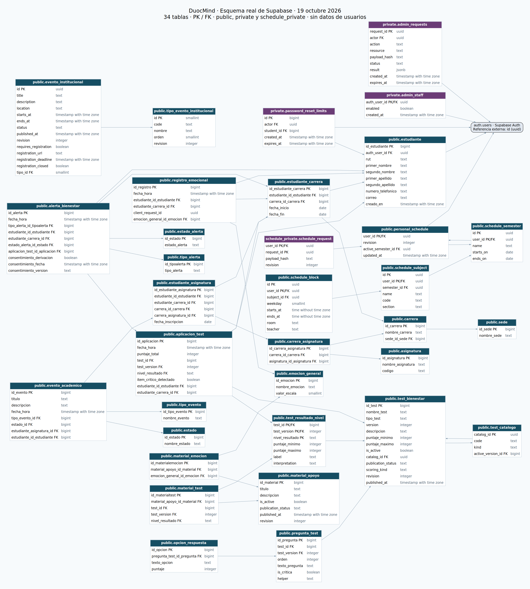

# Esquema de Supabase

Captura estructural del proyecto **Duocmind** (`ashgvanzjeaeekpygqgy`), consultada el **19 de octubre de 2026**, zona America/Santiago, mediante consultas de solo lectura al catálogo de PostgreSQL 17.6. Corresponde al proyecto configurado en la aplicación.

Incluye los esquemas de aplicación `public`, `private` y `schedule_private`: **34 tablas, 34 funciones y 37 políticas RLS**, además de columnas, claves primarias y foráneas, restricciones, índices, triggers, secuencias y privilegios. No contiene filas de tablas, sesiones, contraseñas ni claves. Las referencias a `auth.users` se muestran como dependencia externa administrada por Supabase.

| Archivo | Contenido |
| --- | --- |
| [esquema.sql](esquema.sql) | DDL estructural derivado de los catálogos remotos; incluye ACL actuales y políticas RLS. |
| [esquema.json](esquema.json) | Metadatos originales para cotejar el SQL y regenerar la imagen. |
| [esquema.png](esquema.png) | Imagen del modelo con columnas, tipos y marcas PK/FK; cada flecha representa una FK real. |
| [esquema.svg](esquema.svg) | Mismo diagrama, ampliable sin pérdida de calidad. |
| [esquema.dot](esquema.dot) | Fuente Graphviz del diagrama. |



Para regenerar las imágenes desde la fuente DOT, con Graphviz instalado, ejecutar desde la raíz del repositorio:

```bash
dot -Tsvg 'Fase 2/Evidencias Proyecto/Base de datos/esquema.dot' -o 'Fase 2/Evidencias Proyecto/Base de datos/esquema.svg'
dot -Tpng 'Fase 2/Evidencias Proyecto/Base de datos/esquema.dot' -o 'Fase 2/Evidencias Proyecto/Base de datos/esquema.png'
```

El diagrama requiere Graphviz. La imagen entregada se generó con Graphviz WASM a partir del mismo DOT. Las cabeceras moradas distinguen las tablas operativas de `private` y `schedule_private`; las azules corresponden a `public`.

Las herramientas auxiliares locales y sus dependencias se excluyen de Git mediante `.gitignore`; se conservan las evidencias SQL, JSON, DOT, SVG y PNG.

La exportación es evidencia estructural, no un respaldo integral ni una migración para aplicar sobre la base existente. Requiere un entorno Supabase con sus roles, extensiones y Auth. No exporta los esquemas administrados por Supabase, Edge Functions, configuración del servicio, valores actuales de secuencias ni datos de catálogos. Las publicaciones Realtime quedan documentadas como comentarios; los privilegios por defecto se conservan como metadatos en el JSON. No se ha ejecutado una restauración.

La fuente reproducible del backend está en las [migraciones versionadas](../../../DuocMind/supabase/migrations/), [funciones](../../../DuocMind/supabase/functions/) y [configuración](../../../DuocMind/supabase/config.toml). No ejecutar este SQL sobre el proyecto remoto para actualizarlo.
